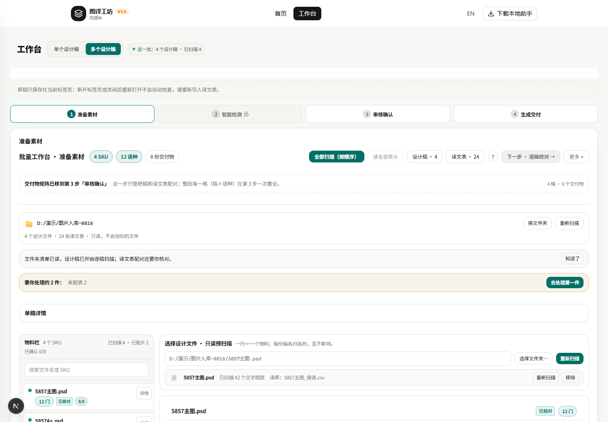
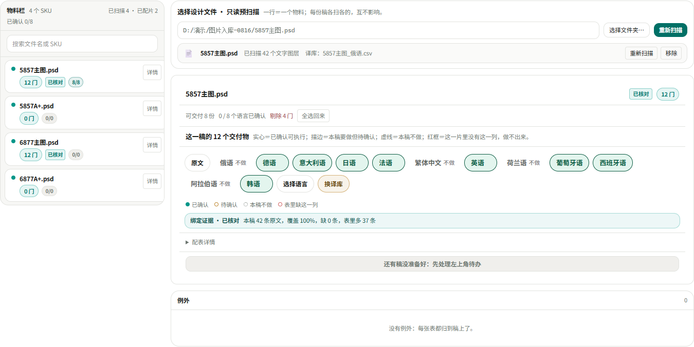

# 第 1 步按你的图 1 改了：两栏落地情况，以及图 2–图 5 还差在哪

日期：2026-10-30　｜　对象：`worktrees/develop` 的多稿批量工作台　｜　验证环境：本机 `127.0.0.1:3000` 现跑的 dev（PID 34156，未重启）

---

## 一、一句话结论

**你说得对，上一份报告拿的是改版前的截图，所以你眼里"一点没动"。** 现在第 1 步真按图 1 做成了两栏：左边是 PSD（物料栏），右边是选中那一稿的交付物和它的译文表。下面两张是本机刚截的真图，不是模拟件。

但图 1 里有三处**不是版式、而是模型和功能**，按你此前拍的"只做显示层"，我没有动；图 2–图 5 的版式刀已经写进代码，可演示环境没有真扫描、真确认，界面只能出空壳，我不拿空壳截图糊弄你。逐条写在第四、五节。

---

## 二、现在的第 1 步

*顶部：标题「批量工作台 · 准备素材」＋三个数（SKU / 语种 / 交付物），全部扫描做成主色按钮；往下依次是文件夹、要你处理的待办。*

*主体两栏：左「物料栏」= 一份稿一个物料，右边是选中那一稿的「选择设计文件 · 只读预扫描」＋「这一稿的 12 个交付物」。*

右栏逐块对着图 1 复刻：文件路径行＋「选择文件夹…／重新扫描」；文件卡片（已扫描 42 个文字图层 ＋ 译库名 ＋ 重新扫描／移除）；标题「这一稿的 12 个交付物」＋四态说明一句；胶囊行（原文 ＋ 8 门实做 ＋ 4 门虚线「不做」）；四态图例；绑定证据条；底部「下一步：智能检测」。

改动落在 `src/components/workbench/step1-stage-view.tsx`（表头 :1768、胶囊行 :1330、归属切片条 :1096、证据条 :1500），新增 10 条中英文案进 `src/lib/i18n/dict-en.json`。

---

## 三、与图 1 逐处对照

| 图 1 上的东西 | 现在 | 说明 |
|---|---|---|
| 标题＋三个数（SKU／语种／交付物） | ✅ 一样 | 前两个走主色浅底，第三个灰底，与图 1 一致 |
| 左上「全部扫描（按顺序）」主色按钮 | ✅ 一样 | |
| 左物料栏：一份稿一行，带状态与 8/8 这类数 | ✅ 结构一样 | 徽章文字沿用现有口径（「12 门」「已核对」），没改成图 1 的「实证」 |
| 右「选择设计文件 · 只读预扫描」＋路径行＋文件卡片 | ✅ 一样 | 扫描图层数与译库名都照图 1 摆 |
| 「这一稿的 12 个交付物」＋四态说明 | ✅ 一样 | |
| 原文胶囊 ＋ 8 门实做 ＋ 4 门虚线「不做」 | ✅ 一样 | |
| 四态图例（已确认／待确认／本稿不做／表里缺那一列） | ✅ 一样 | |
| 绑定证据条 | ⚠️ 有，但是「已核对」不是图 1 的绿色「实证」 | 实证要真扫描＋真确认，演示环境没有 PS |
| 「主表A_通用8语.xlsx ｜ 组库 · 4 稿共用 ｜ 归属值 主图组 ｜ 8 列 · 这一片 8 个交付物」这一行 | ❌ 演示里不出现 | 这一行只在"这一稿的归属已确认"后才渲染（`step1-stage-view.tsx:1098` 取 fingerprint，没有就返回空） |
| 右上「配表提案（按命名规则）」「清除全部」 | ❌ 没做 | 两个都是功能按钮（触发归组／清空），不是版式；见第五节 |
| 一张表带 8 门语言 | ❌ 做不到 | 现在的模型是「一张表＝一门语言」，见第五节第 1 条 |

---

## 四、还差的四处，分别要付什么代价

**1）一张主表带 8 门语言 —— 这条最要紧，它是图 1／图 2 的前提。**

图 1 里「主表A_通用8语.xlsx」一张表就有 8 个语言列。但代码里一张表只认第一门语言：`src/lib/workbench/group-binding.ts:152`（`table.langs?.[0]`）。所以今天要给一稿上 12 门，得先有 12 张表（我截图里就是 24 张表＝2 稿 × 12 门）。这属于绑定模型的改动，会牵动第 1/2/3 步的取数口和契约测试，**不是显示层**。你此前拍的是"只做显示层"，所以我没碰——要不要开这一刀，你一句话我就排。

**2）实心绿「已确认」＋「主表 · 归属值」那一行 ＋ 绿色「实证」。**

这三样都要真数据：实心＝这一门已确认可执行；主表行＝这一稿的归属已落库；实证＝扫描过真实文字图层并与表对得上。演示环境没有 Photoshop，这三样只能是描边（待确认）与「已核对」。**真机跑一稿就能看到它们**，这也是我建议下一步做的事。

**3）「配表提案（按命名规则）」「清除全部」两个按钮没做。**

它们背后是"按文件名给稿配表"和"一键清空"两个动作。这次的授权范围是显示层，加了按钮却不接真实动作，就等于给一个点了没反应的按钮——比不做更糟，所以我留着没加。要加，得连动作一起做。

**4）左栏徽章口径没改成图 1 的「实证」。**

图 1 左栏每行是「实证 8/8」，现在的实现是「12 门 已核对 8/8」。徽章背后是证据分级（实证／推定／未配译库），显示层能改，但改了会动到已有的证据分级门禁（`smoke-batch-workbench-guards` 63 项里有一批是钉这枚徽章的）。这属于"再等一刀"，不是漏做。

---

## 五、第 2／3／4 步的现状：版式已在代码里，数据出不来

- 第 2 步「智能检测」的行清单已经在代码里：`src/components/workbench/review-step.tsx:1032`（逐行摊开、列裁、默认只列问题行、分页）。
- 第 3 步「审核确认」的交付物矩阵、第 4 步「生成交付」的执行进度与份口径，前几刀已落（`step1-stage-view.tsx`、`review-step.tsx` 与 `workbench-view.tsx` 对应块）。
- **但演示环境里这三步只能显示空壳**：第 2 步的"下一步"在当前演示数据下是禁用的（演示里没有"逐稿校对完成"这件事），第 3 步矩阵会显示「本稿要做 8 语、库里有 0 列」，第 4 步则提示"先在第 1 步导入译文表"。这些红字是演示数据不完整造成的，不是产品判断。

所以这次我只交第 1 步的真截图。**要看到图 3／图 4／图 5 那样的实况，必须真机跑一遍：装助手 → 真 PSD 扫描 → 真表读入 → 逐门确认。** 这一步我随时能做，等你点头。

---

## 六、门禁（本机刚跑，8 项全绿）

| 命令 | 结果 |
|---|---|
| `npx tsc --noEmit` | 退出码 0 |
| `npm run test:wb-four-screens` | 退出码 0（含 token 门 41/41） |
| `npm run test:step1-mock-contract` | 判据 102 项 · 失败 0 |
| `npm run test:workbench-ui-contract` | ok |
| `npm run test:workbench-scope` | ok（53 条断言） |
| `npm run test:batch-workbench-guards` | passed 63 checks |
| `npm run test:en-workbench` | 17 assertions passed |
| `npm run i18n:guard` | 词典覆盖 1508/1508（100%） |

日志留底：`worktrees/develop/tmp/wb-v3-four-screens-20261030/gates-final/`。

**边界**：只改了显示层与文案；服务端、助手、计费与积分的契约四层、执行算法、覆盖算法、env flag、首页 `.home-v17`、探针页一律没动；没有提交、没有推送、没有部署。

---

## 七、等你拍两件事

1. **要不要开「一张表带多门语言」这一刀？**（图 1／图 2 的前提，动绑定模型与契约测试，预计是这一轮里最重的一刀）
2. **要不要我现在真机跑一稿？**（装助手、真扫描、真确认，把图 3／图 4／图 5 那样的实况截给你，顺带把上面第 2 处补齐）

你不拍也行：我先按"只做显示层"把剩下的细处（左栏徽章口径、图 1 的语种排序）收干净。
